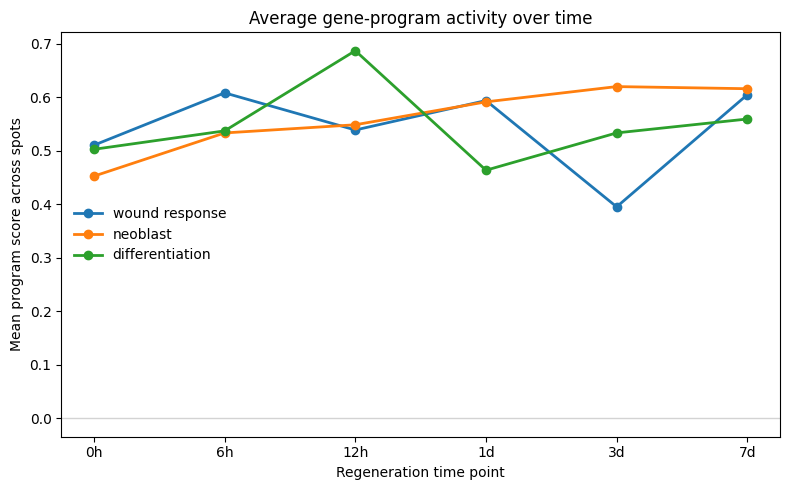
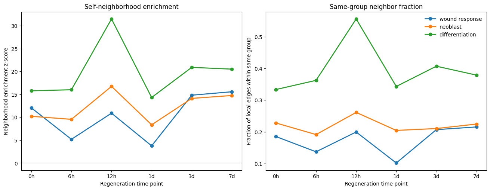

# Spatial Reorganization of Gene Programs During Planarian Regeneration

An exploratory spatial transcriptomics project studying how wound-response, neoblast, and differentiated-tissue gene programs change across six regeneration time points in *Schmidtea mediterranea*. Developed for STAT 530 at the University of Illinois Urbana-Champaign using **Scanpy** and **Squidpy**.

**[Read the analysis notebook](project.ipynb)** — includes the code, saved tables, spatial maps, and interpretations.

## Research questions

1. Which genes show the strongest spatial organization at each regeneration time point?
2. How do regeneration-associated gene programs change across space and time?
3. Do high-scoring program regions become more spatially clustered over time?
4. Which genes characterize these program-defined spatial niches?

## Analysis workflow

The notebook uses one A1 section with `Z_3D == 1.0` per time point, retaining in-tissue spots when that annotation is available.

| Time point | Selected section | Spots |
| --- | --- | ---: |
| 0h | `cut0h_A1` | 977 |
| 6h | `cut6h_A1` | 870 |
| 12h | `cut12h_A1` | 1,115 |
| 1d | `cut24h_A1` | 901 |
| 3d | `cut3d_A1` | 1,231 |
| 7d | `cut7d_A1` | 1,176 |

- **Preprocessing:** retain input expression in a counts layer, normalize to 10,000 counts per spot, log-transform, select 2,000 highly variable genes, compute PCA and expression/spatial neighbor graphs.
- **Spatial genes:** rank highly variable genes using Moran's I; inspect rankings and tissue overlays.
- **Gene programs:** derive neoblast markers and epidermal/muscle/neuronal markers from the annotated single-cell reference using Wilcoxon rankings. Define an early wound-associated gene set by comparing pooled 6h/12h/24h cells with the 0d reference. Score the resulting programs in spatial spots.
- **Spatial domains:** flag the top quartile of each program within each time point. Assign overlapping spots to the qualifying program with the highest standardized score; label remaining spots `other`. Quantify neighborhood enrichment with 100 permutations and seed 0.
- **Niche markers:** compare each high-program group with `other` spots using Wilcoxon differential expression and visualize candidate markers.

The 1d tissue image and coordinates are flipped horizontally for display only, following the orientation check described in the notebook. Spatial statistics use the original coordinates.

## Main observations

The saved results show strong spatial structure throughout regeneration, with program-specific changes rather than a uniformly increasing degree of clustering.

- Mean neoblast scores rise from about 0.45 at 0h to about 0.62 at 3d and remain similar at 7d.
- Wound-associated and differentiation scores vary non-monotonically across time.
- All three high-program groups show positive self-neighborhood enrichment at every time point. Differentiation-associated domains have the strongest enrichment, peaking at 12h.
- `SMED30007406`, `SMED30019803`, and `SMED30030234` recur among candidate neoblast-niche markers.





These observations describe the selected tissue sections. Program scores do not directly estimate cell abundance, and program-defined niches are operational labels rather than independently validated cell states. Marker discovery uses the same expression data as the program-based grouping, so enriched genes are exploratory candidates. Spot-level tests also do not establish biological replication across animals.

## Data sources

This project reanalyzes data from **Cui et al. (2023), “Spatiotemporal transcriptomic atlas reveals the dynamic characteristics and key regulators of planarian regeneration,” Nature Communications 14, 3205.** [Paper and data-availability statement](https://www.nature.com/articles/s41467-023-39016-0) · [DOI](https://doi.org/10.1038/s41467-023-39016-0).

The processed expression data are publicly available through **[OMIX003867](https://ngdc.cncb.ac.cn/omix/release/OMIX003867)**:

| Download | Accession file | Use in this project |
| --- | --- | --- |
| [Scanpy_Visium.zip](https://download.cncb.ac.cn/OMIX/OMIX003867/OMIX003867-03.zip) | `OMIX003867-03` | Six Visium `.h5ad` files |
| [singlecell_h5ad.zip](https://download.cncb.ac.cn/OMIX/OMIX003867/OMIX003867-01.zip) | `OMIX003867-01` | `adata_scRNA_Annotated.h5ad` marker reference |

Related study resources: [H&E images, OMIX003889](https://ngdc.cncb.ac.cn/omix/release/OMIX003889), [raw sequencing data, CRA007941](https://ngdc.cncb.ac.cn/gsa/browse/CRA007941), and the [authors' analysis repository](https://github.com/yangteam/Spatiotemporal-transcriptomic-atlas-of-planarian-regeneration). The raw sequencing and separate image archives are not required by this notebook when using the processed `.h5ad` files with embedded spatial images.

Data are downloaded separately and are not redistributed in this repository. Please cite the original study when reusing them.

## Run locally

Use Python 3.12. The versions in `requirements.txt` were recorded from the available local environment; they are not a historical lockfile for the original notebook run.

```bash
python3.12 -m venv .venv
source .venv/bin/activate
python -m pip install -r requirements.txt
```

Download and extract the two expression archives, then arrange the files as follows (adjust any nested archive directories as needed):

```text
data/
├── Scanpy_Visium/
│   ├── Visium_0hpa.h5ad
│   ├── Visium_6hpa.h5ad
│   ├── Visium_12hpa.h5ad
│   ├── Visium_1dpa.h5ad
│   ├── Visium_3dpa.h5ad
│   └── Visium_7dpa.h5ad
└── singlecell_h5ad/
    └── adata_scRNA_Annotated.h5ad
```

Start Jupyter from the repository root and run the notebook cells in order:

```bash
jupyter lab project.ipynb
```

To keep the data elsewhere, set the data root before launching Jupyter:

```bash
export PLANARIAN_DATA_DIR="/path/to/data"
jupyter lab project.ipynb
```

The single-cell reference is loaded into memory and ranked across genes, so allow sufficient RAM. Saved notebook outputs and README figures are retained from the original analysis. Publication preparation checked notebook structure and Python syntax; a full rerun was not performed because the input datasets were unavailable in the current workspace.

## Repository contents

| File | Purpose |
| --- | --- |
| `project.ipynb` | Analysis code, saved outputs, and biological interpretation |
| `figures/` | Selected figures extracted from saved notebook outputs |
| `requirements.txt` | Direct analysis and Jupyter dependencies |
| `.gitignore` | Excludes local data, HTML exports, course reference material, and temporary files |

The original project blueprint was used to organize this README. Course reference files in `sources/`, HTML exports, and the blueprint text file are excluded from version control.
